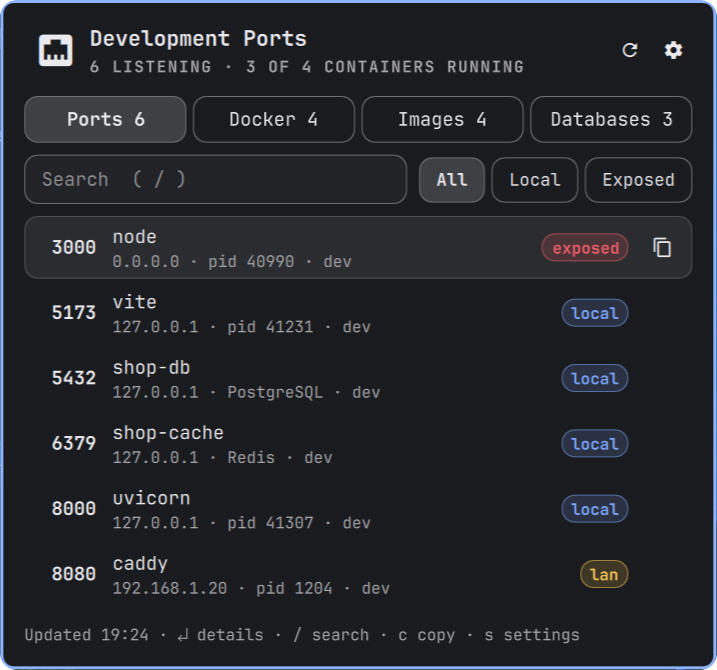

# Development Ports

An Omarchy bar widget that shows what is running on your machine while you develop:
listening TCP ports with their process and exposure, Docker containers, images and
volumes, and databases found among them. It only reads; it never stops, starts or
changes anything.



The bar shows a single icon; hover it for a summary. Click it to open the panel;
right-click to refresh.

## Install

```bash
omarchy plugin add https://github.com/batuhanmeral/omarchy-dev-ports --enable
```

Omarchy clones the repository into `~/.config/omarchy/plugins/io.github.batuhanmeral.devports`
and asks where to place the widget (it defaults to the right side of the bar).

If `omarchy plugin add` reports `invalid plugin id` under a Turkish (or similar) locale,
run it as `LC_ALL=C.UTF-8 omarchy plugin add ...`. Omarchy's validator uses a
locale-dependent character range.

Update with `omarchy plugin update io.github.batuhanmeral.devports`, remove with
`omarchy plugin remove io.github.batuhanmeral.devports`.

### Requirements

- Omarchy 4.5 or newer (Quickshell / Qt 6 plugin API)
- Python 3.11+ and `ss` (iproute2), both present on a standard Omarchy install
- Optional: Docker CLI with access to a local Unix socket, `wl-copy` for copying,
  `xdg-open` for opening URLs

Access to the Docker socket grants root-equivalent privileges on the host, even though
this widget only runs read commands. Remote Docker contexts (TCP/SSH) are refused.

## Using the panel

| Key | Action |
| --- | --- |
| `↑` `↓` / `j` `k` | Move through the list |
| `←` `→` / `h` `l` | Switch tab in the list |
| `Enter` | Open details |
| `→` / `l` in details | Show container logs (last 100 lines) |
| `←` / `h` in details | Back |
| `Esc` | Back, clear the search, then close |
| `/` | Search |
| `c` | Copy the URL, address or name |
| `o` | Open a known web service in the browser |
| `1`–`4` | Switch tab |
| `r` | Refresh now |
| `s` | Settings |

In details, click any value to copy it. Settings (refresh interval, Docker on/off,
exposure filter, hidden ports, visible tabs, sort order, compact rows, SQLite files) are
stored in Omarchy's `shell.json`.

Container logs are fetched only when you ask for them, are never written to disk, and
can contain whatever secrets your application logs.

## Development

```bash
make setup   # checks that the tools exist; installs nothing
make check   # Ruff, Pyright, Python/Node/QML tests, qmllint, manifest validation, coverage, Gitleaks
make fix     # apply Ruff and qmlformat formatting
```

To try a change in the running shell, copy the working tree over the installed plugin
directory and run `omarchy restart shell`.

Detailed setup notes, manual acceptance scenarios and design records are kept in
`.docs/`, written in Turkish and not tracked in Git.

## License

[MIT](LICENSE)
